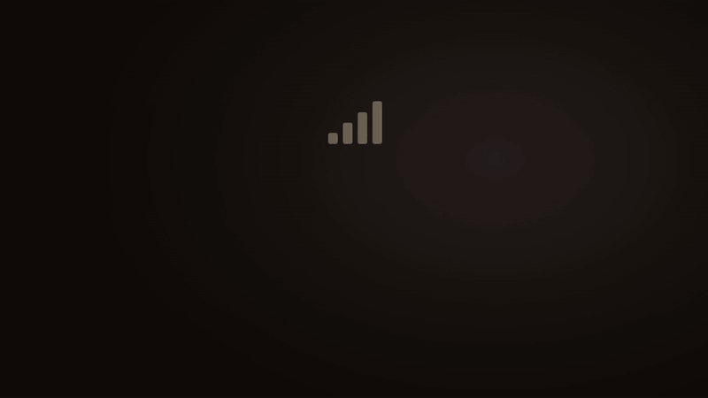

<h1 align="center">Ciao, sono Noemi</h1>

  Faccio la DM e costruisco strumenti per il gioco di ruolo: nascono al mio tavolo, per necessità o per curiosità. 
  <i>I'm a Dungeon Master building tools for tabletop RPGs, born at my own table.</i>

  
  
  

---

## Pocket GM Screen

**Tutta la campagna, in tasca.** Lo schermo del DM che ho creato perché dove giochiamo internet non c'è: D&D 5e (2014 e 2024) nel browser, anche offline, gratis e senza pubblicità.

  

- **Preparare**: wiki con PNG, luoghi, fazioni e quest collegati con @, segreti del DM, trame e Sessione Zero.
- **Il mondo**: calendario con lune e meteo, Cartografo per regni, città e dungeon, esagoni da esplorare, Scrittoio per documenti e stemmi.
- **Al tavolo**: scontro con iniziativa e PF, schermo del DM, Compendio SRD, generatori e musica.
- **Con il gruppo**: vista per i giocatori e un altro DM nella stessa campagna, in tempo reale.

  <a href="https://youtu.be/VDOrEB4ioKI"><b>Guarda il trailer</b></a> ·
  <a href="https://pocketgmscreen.pages.dev/?demo=1"><b>Prova la campagna di esempio</b></a> ·
  <a href="https://pocketgmscreen.pages.dev/">Apri l'app</a> ·
  <a href="https://pocketgmscreen.pages.dev/scopri/">Tutte le funzioni</a> ·
  <a href="https://github.com/gdr-sys/dm-toolkit">Codice</a>

---

## Altri strumenti per il gioco di ruolo

| | |
|---|---|
| [**Compendio Incantesimi Homebrew**](https://gdr-sys.github.io/Compendio-incantesimi-homebrew/) | Incantesimi SRD 2014 e 2024 e homebrew: mazzi per personaggio, slot, concentrazione e carte da stampare. |
| [**Scheda personaggio D&D**](https://gdr-sys.github.io/Scheda-personaggio-dnd-interattiva/) | Scheda interattiva con combattimento, incantesimi e inventario, solo browser. |
| [**Generatore di tesori**](https://dnd-loot-generator-sepia.vercel.app) | Tesori casuali con le tabelle del DMG 2014 e 2024. |
| [**The Hungry Dragon**](https://gdr-sys.github.io/The-Hungry-Dragon/) | Menu di taverne e locande pronti per il tavolo. |
| [**NPC Forge**](https://gdr-sys.github.io/NPC-Forge/) | PNG istantanei per fantasy, fantascienza, horror e moderno. |
| [**Brancalonia, generatore tuttofare**](https://gdr-sys.github.io/Brancalonia---Generatore-Tuttofare/) | Per lo spaghetti fantasy più cialtrone d'Italia. |
| [**Daggerheart Dice & Tracker**](https://daggerheart-dice-and-tracker.vercel.app) | Dadi e tracciamento per Daggerheart. |
| [**7th Sea**](https://gdr-sys.github.io/7th-sea-dice-roller/) | Dadi con d10 che esplodono e [scheda interattiva](https://gdr-sys.github.io/Scheda-7th-sea-interattiva/). |

Tutte le mie webapp per il gioco di ruolo sono raccolte su **[GDR Toolbox](https://gdr-toolbox.noemi-marcolini.workers.dev/)**.

## Altre app

[Image Optimizer Pro](https://gdr-sys.github.io/Image-Optimizer-Pro/) (ottimizza migliaia di immagini nel browser, senza caricarle) · [Cinememory](https://gdr-sys.github.io/Cinememory/) (oggi nella storia del cinema) · [Subscription Manager](https://subscription-manager-plum.vercel.app) · [FlashMind](https://flash-mind-khaki.vercel.app)

---

  Se i miei strumenti ti sono utili al tavolo, puoi <a href="https://ko-fi.com/noemimarcolini">offrirmi un caffè su Ko-fi</a>: aiuta a pagare dominio e server. 
  <i>If my tools help at your table, you can <a href="https://ko-fi.com/noemimarcolini">buy me a coffee</a>.</i>

